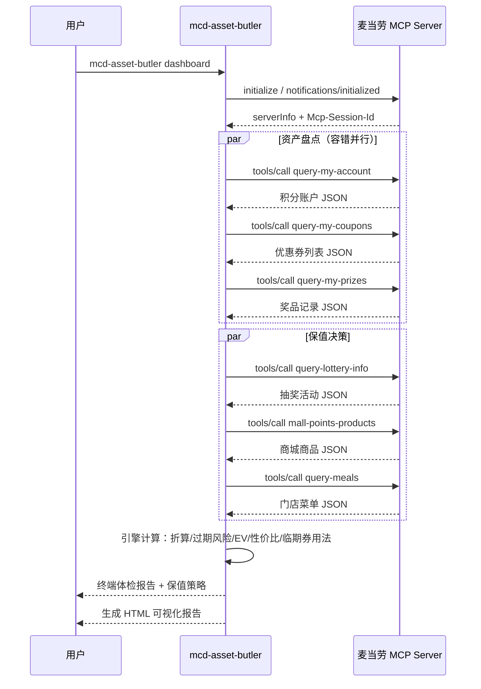

# MCP_INTEGRATION.md — 麦当劳 MCP 集成说明

本文档说明 `mcd-asset-butler` 实际使用的麦当劳 MCP Server、Tool、调用流程与业务价值。

## 1. MCP Server

| 项 | 值 |
|---|---|
| 服务名称 | 麦当劳中国 MCP Server（mcd-mcp） |
| 接入地址 | `https://mcp.mcd.cn` |
| 传输协议 | Streamable HTTP（JSON-RPC 2.0 over HTTP POST） |
| 鉴权方式 | 请求头 `Authorization: Bearer <MCP_TOKEN>` |
| Token 申请 | <https://open.mcd.cn/mcp>（手机号登录 → 控制台 → 激活） |
| 限流 | 600 次/分钟/Token |
| 官方文档 | <https://github.com/M-China/mcd-mcp-server> |

本项目的 MCP 客户端为**纯 Python 标准库实现**（`mcp_client.py`，约 200 行，零第三方依赖），
完整实现了 MCP Streamable HTTP 传输所需的最小闭环：

```
initialize ──► notifications/initialized ──► tools/list ──► tools/call ──► ...
```

- 自动管理 `Mcp-Session-Id` 会话头
- 同时兼容 `application/json` 单体响应与 `text/event-stream`（SSE）流式响应
- 对 `result.content` 中的 text 段自动尝试 JSON 还原
- 工具返回结构**容错解析**：不假设固定字段层级，在嵌套 JSON 中定位关键字段，
  单工具数据异常只降级该模块，不影响整体体检（详见 `models.py` 的 `find_dicts/find_lists/pick`）

## 2. 实际使用的 Tool 清单

本项目共调用 **12 个**麦当劳 MCP 工具，按用途分为四组：

### A. 资产盘点组（体检数据源）

| Tool | 用途 | 在本项目中的角色 |
|---|---|---|
| `query-my-account` | 我的积分查询（可用/累计/冻结/即将过期） | 积分资产本金 + 过期风险金额的唯一数据源 |
| `query-my-coupons` | 我的优惠券查询 | 券资产本金；解析面额、门槛、到期日 |
| `query-my-prizes` | 查看我的奖品 | 已中奖品计入资产盘点，避免「中了奖却忘了用」 |

### B. 保值决策组（策略引擎数据源）

| Tool | 用途 | 在本项目中的角色 |
|---|---|---|
| `query-lottery-info` | 积分抽奖活动信息（奖品列表/概率/消耗） | 计算抽奖期望值 EV = Σ(概率 × 奖品估值) |
| `mall-points-products` | 麦麦商城可兑换商品 | 计算兑换性价比 = 商品估值 ÷ 所需积分，生成排行榜 |
| `query-meals` | 当前门店在售餐品 | 临期券的「推荐用法」候选池（适用餐品匹配） |

### C. 一键执行组（行动闭环）

| Tool | 用途 | 在本项目中的角色 |
|---|---|---|
| `available-coupons` | 麦麦省可领券列表 | 「待领取」清单展示 |
| `auto-bind-coupons` | 麦麦省一键领券 | `claim` 命令一键增收，把「可领未领」变为「已持有」 |
| `draw-lottery` | 积分抽奖 | `lottery --draw` 在 EV 分析后按用户意愿执行 |

### D. 上下文组

| Tool | 用途 | 在本项目中的角色 |
|---|---|---|
| `campaign-calendar` | 当月营销活动日历 | 增收线索（双倍积分日、会员日等） |
| `now-time-info` | 服务端当前时间 | 过期倒计时的时间基准 |

## 3. 典型调用流程（以 `dashboard` 命令为例）



## 4. 业务价值：为什么做「积分 & 券资产管理」

麦当劳 MCP 已开放 35 个工具，社区作品大多集中在**省钱**（优惠券组合）与**营养**（热量搭配）
两个方向。而会员账户里还有两类容易被忽视的资产：

1. **积分**：官方口径 100 积分 ≈ ¥1，但大量积分在「即将过期」状态被清零；
   积分有三种处置方式（抽奖 / 商城兑换 / 直接抵扣），**单位价值差异可达 2 倍**，却缺少量化对比。
2. **优惠券**：临期券过了门槛就作废，用户常常「有券却不知道怎么用最值」。

本项目把这两类资产统一为一张「资产账本」，提供三段式价值：

| 阶段 | 能力 | 解决什么问题 |
|---|---|---|
| 体检 | 资产折算、7 天过期倒计时、风险占比 | 「我的积分和券到底值多少钱、哪些快过期了」 |
| 策略 | 积分处置 EV/性价比排序、临期券推荐用法 | 「积分该抽还是该换、临期券怎么用不浪费」 |
| 执行 | 一键领券、抽奖、兑换引导 | 「别只给建议，给我一键做完」 |

核心算法（`engine.py`，纯函数、可单测）：

- **积分处置性价比** = 每 100 积分可获得的商品价值（分）。直接抵扣恒为 100 分；
  抽奖 = EV × 100 ÷ 单次消耗；兑换 = max(商品估值 × 100 ÷ 所需积分)。
- **临期券最优用法**：以「券后实付最低」为目标，在门店菜单候选集中搜索单品/双单品组合，
  且**券面提及的餐品优先进入候选**（如「板烧鸡腿堡半价券」只搭配板烧鸡腿堡），
  组合原价需达到用券门槛；结果按官方 `calculate-price` 口径（原价 − 券面额）校验。
- **过期风险**：7 天内到期的券面额 + 即将过期积分，统一折算金额并给出占比告警。

## 5. 离线演示模式（无 Token 复现全流程）

真实联调需要用户在 <https://open.mcd.cn/mcp> 自行申请 MCP Token（绑定个人会员账户）。
为降低体验门槛，项目内置 `--demo` 模式：`DemoMCPClient` 以与官方 Tool 说明相符的
模拟数据结构回放全流程（结构、字段命名遵循官方 README），

```bash
python -m mcd_asset_butler dashboard --demo
```

演示数据**仅用于本地演示与测试**，不代表任何真实账户；真实数据请配置
`MCD_MCP_TOKEN` 后去掉 `--demo` 使用。README 中的演示 GIF 与报告截图均由 demo 模式生成。

## 6. 安全与合规

- Token 仅通过 `--token` 参数或 `MCD_MCP_TOKEN` 环境变量注入，**不落盘、不进仓库**
- `mcp-config.example.json` 只含 `${MCD_MCP_TOKEN}` 环境变量占位符
- 遵循 MCP 服务限流（600 次/分钟），采集层对失败工具自动降级并提示
- 项目输出仅供参考，不构成任何专业建议；餐品、价格与库存以麦当劳官方渠道实时结果为准
