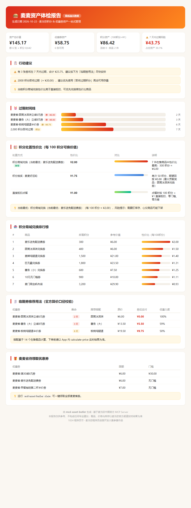

<div align="center">

# 🍔 麦麦资产管家 · mcd-asset-butler

**你的麦当劳积分和优惠券，可能正在悄悄过期。**

基于麦当劳中国官方 MCP Server 的积分 & 优惠券资产管理 Skill：
资产体检 → 保值策略 → 一键执行 → 可视化报告，一条闭环。

[](https://github.com/M-China/mcd-developer-innovation-challenge)
[](https://open.mcd.cn/mcp)
[](https://www.python.org/)
[](#安装)
[](#测试)
[](./LICENSE)

</div>

---

## 🎬 30 秒上手（无需任何 Token）

```bash
git clone https://github.com/mark-zhaofei/mcd-asset-butler.git
cd mcd-asset-butler
PYTHONPATH=src python -m mcd_asset_butler dashboard --demo
```


**一句话**：算清你的麦当劳积分和券值多少钱、哪些快过期、积分该抽奖还是该兑换，然后一键领券 / 抽奖 / 生成可视化报告。



> 报告为单文件 HTML（零外部资源），`report` 命令一键生成，可直接分享或打印。

## 💡 为什么做这个项目？

每个麦当劳会员账户里都躺着两类「沉默资产」：

- **积分**：官方口径 100 积分 ≈ ¥1。大量积分处于「即将过期」状态被清零；
  而积分有三种花法——**抽奖 / 商城兑换 / 直接抵扣**，单位价值差异最高可达 2 倍，却从来没有人帮你算过哪条路最值。
- **优惠券**：临期券一过门槛就作废。你有券，却常常不知道怎么用才不浪费。

`mcd-asset-butler` 把这两类资产统一成一张账本，回答三个问题：

> **① 我的积分和券到底值多少钱？哪些快过期了？**
> **② 积分该抽还是该换？临期券怎么用实付最低？**
> **③ 别只给建议——一键帮我领了、换了、抽了。**

在社区作品普遍聚焦「省钱搭配」「营养计算」的赛道里，本项目选择了几乎空白的
**「积分资产」维度**：用期望值（EV）和性价比排序把积分花法变成一道有数据支撑的选择题。

## ✨ 功能一览

| 命令 | 能力 | 说明 |
|---|---|---|
| `checkup` | 🩺 资产体检 | 券/积分/奖品统一折算金额，7 天过期倒计时与风险占比 |
| `strategy` | 🧮 保值策略 | 积分处置性价比排序（抽奖 EV vs 商城兑换 vs 直接抵扣）+ 临期券推荐用法 |
| `claim` | 🎁 一键增收 | 自动领取麦麦省全部可领优惠券 |
| `exchange` | 🏪 兑换排行榜 | 商城商品按「每 100 积分价值」排序，一眼看出谁最划算 |
| `lottery` | 🎰 抽奖分析 | 奖品概率 × 估值算期望值，`--draw` 按需执行 |
| `report` | 📊 可视化报告 | 生成单文件 HTML 体检报告（可分享、可打印） |
| `dashboard` | 🚀 一键全流程 | 体检 + 策略 + 报告，一条命令全做完 |

**工程特性**：

- 🔌 **纯标准库 MCP 客户端**：手写 Streamable HTTP / JSON-RPC 传输，零运行时依赖
- 🛡️ **容错解析**：单工具数据异常自动降级，部分失败也能出报告
- 🧪 **16 个单元测试**：解析器、EV 计算、适用餐品匹配全覆盖
- 📴 **离线演示模式**：无 Token 也能完整体验（`--demo`）

## 🚀 快速开始

### 1. 获取 MCP Token（真实数据）

前往 <https://open.mcd.cn/mcp>，手机号登录 → 控制台 → 激活，复制 Token。

### 2. 运行

```bash
# 方式一：pip 安装（零依赖）
pip install .
mcd-asset-butler dashboard

# 方式二：源码运行
PYTHONPATH=src python -m mcd_asset_butler dashboard

# 方式三：无 Token 体验演示模式（模拟数据）
PYTHONPATH=src python -m mcd_asset_butler dashboard --demo
```

Token 通过参数或环境变量提供（二选一）：

```bash
mcd-asset-butler dashboard --token <你的MCP_TOKEN>
export MCD_MCP_TOKEN=<你的MCP_TOKEN>   # 之后所有命令免传参
```

### 3. 接入任意 MCP Client（Cherry Studio / Cursor / WorkBuddy）

```json
{
  "mcpServers": {
    "mcd-mcp": {
      "type": "streamablehttp",
      "url": "https://mcp.mcd.cn",
      "headers": { "Authorization": "Bearer ${MCD_MCP_TOKEN}" }
    }
  }
}
```

> 本项目同时是一个可被 AI Agent 直接调用的 Skill：`MCP_INTEGRATION.md` 中完整说明了
> 12 个工具的使用方式与调用流程，Agent 可据此编排更复杂的个人资产管理流程。

## 🧮 核心算法

**积分处置性价比**（每 100 积分可获得的商品价值，分）：

| 处置方式 | 计算 |
|---|---|
| 直接抵扣 | 恒为 100 分（100 积分 = ¥1） |
| 积分抽奖 | EV × 100 ÷ 单次消耗，EV = Σ(奖品概率 × 奖品估值) |
| 商城兑换 | max(商品估值 × 100 ÷ 所需积分) |

**临期券最优用法**：以「券后实付最低」为目标，在门店菜单候选集中搜索单品 / 双单品组合；
券面提及的餐品优先进入候选（「板烧鸡腿堡半价券」只搭配板烧鸡腿堡），
组合原价需达到用券门槛，结果按官方算价口径（原价 − 券面额）校验。

## 🏗️ 项目结构

```
mcd-asset-butler/
├── README.md                    # 本文档
├── CONTEST_DECLARATION.md       # 参赛声明（官方模板原文）
├── MCP_INTEGRATION.md           # MCP 集成说明（工具/流程/业务价值）
├── mcp-config.example.json      # 脱敏配置示例（环境变量占位符）
├── workbuddy.md                 # WorkBuddy 开发上下文
├── pyproject.toml               # 零依赖打包配置
├── src/mcd_asset_butler/
│   ├── mcp_client.py            # 手写 MCP Streamable HTTP 客户端
│   ├── models.py                # 资产模型 + 容错字段解析
│   ├── engine.py                # 分析引擎（折算/风险/EV/性价比/用法匹配）
│   ├── report.py                # HTML 可视化报告生成器
│   ├── demo_data.py             # 离线演示数据
│   ├── service.py               # 采集编排（单工具容错降级）
│   └── cli.py                   # 命令行入口
├── tests/test_engine.py         # 16 个单元测试
├── examples/
│   ├── demo.gif                 # 终端演示动画
│   ├── report.html              # 报告样例（demo 数据）
│   └── report.png               # 报告截图
└── tools/gen_demo_gif.py        # 演示 GIF 生成脚本（开发机使用）
```

## 🧪 测试

```bash
PYTHONPATH=src python -m unittest discover -s tests -v
# Ran 16 tests — OK
```

覆盖：金额/日期解析（分/元/时间戳/多格式）、积分账户嵌套解析、过期券过滤、
抽奖 EV、百分号概率、兑换性价比排序、适用餐品匹配、用券门槛约束、策略建议生成。

## 🎯 目标用户

- **麦当劳重度用户**：积分攒了不少但从没弄清怎么花最值
- **羊毛党进阶玩家**：不满足于「领券」，想把积分也纳入资产化管理
- **MCP / Agent 开发者**：需要一个「个人会员资产」维度的 MCP 编排参考实现

## ⚠️ 免责声明

本项目为 1024 程序员节参赛作品，由参赛者独立开发，**非麦当劳官方产品**。
项目输出仅供参考，不构成任何专业建议；餐品信息、价格、积分与库存以麦当劳
官方渠道的实时结果为准。抽奖期望值不代表实际所得，请理性消费、量力而行。

## 📄 License

[MIT](./LICENSE)

<div align="center">

**如果它帮你把过期积分变成了汉堡，欢迎点个 ⭐ Star！**

1024 程序员节 · 麦当劳程序员创意开发大赛

</div>
